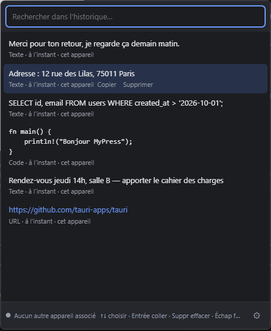
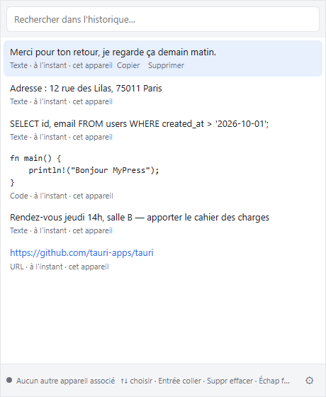
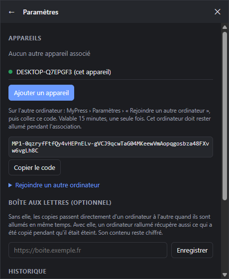

# MyPress

**Votre presse-papiers, sur tous vos ordinateurs.** Copiez sur un PC, collez sur l'autre. Retrouvez tout
ce que vous avez copié avec `Ctrl+Alt+V`, sans compte et sans serveur obligatoire.

<p>
  
  
</p>

> Prototype (version 0.1, Windows). Texte uniquement pour l'instant.
> Cahier des charges : [`input/cahier_des_charges_presse_papiers_universel.md`](input/cahier_des_charges_presse_papiers_universel.md)

## Fonctionnalités

- **Historique** des textes, liens et extraits de code copiés, avec recherche (insensible aux majuscules et aux accents).
- **Panneau rapide** `Ctrl+Alt+V` : flèches pour choisir, `Entrée` colle directement dans l'application d'avant.
- **Synchronisation entre ordinateurs** en pair à pair, même sur des réseaux différents. Quand vous copiez
  sur un PC, l'autre le reçoit et `Ctrl+V` le colle directement.
- **Chiffrement de bout en bout** : personne d'autre que vos appareils ne peut lire votre historique.
- **Fonctionne hors ligne** : tout est enregistré localement et rattrapé à la reconnexion.
- **Respect de la vie privée** : copies des gestionnaires de mots de passe ignorées, mode privé, pause de la synchronisation.
- Taille d'historique au choix (50 à 1000), thème clair ou sombre selon Windows, lancement au démarrage.

## Installation

Télécharger l'installateur de votre système dans les [Releases](../../releases) (produites par
GitHub Actions, voir [plus bas](#construire-les-installateurs)). Les installateurs ne sont pas encore signés.

**Windows** — `MyPress_x.y.z_x64-setup.exe`
1. Le lancer. Si Windows affiche « Windows a protégé votre ordinateur » : *Informations complémentaires* › *Exécuter quand même*.
2. Si le pare-feu demande l'accès au réseau : *Autoriser* (nécessaire pour la synchronisation).

Aucun droit administrateur requis. WebView2 est fourni par Windows 10/11 ; s'il manque, l'installateur le télécharge.

**macOS** — `MyPress_x.y.z_aarch64.dmg` (Apple Silicon) ou `_x64.dmg` (Intel)
1. Ouvrir le `.dmg` et glisser MyPress dans *Applications*.
2. Premier lancement : clic droit sur MyPress › *Ouvrir* › *Ouvrir*. Si macOS indique que l'application est
   endommagée : `xattr -cr /Applications/MyPress.app` dans le Terminal.
3. Autoriser MyPress dans *Réglages Système › Confidentialité et sécurité › Accessibilité* si le raccourci
   global ne répond pas.

**Linux** — `.deb` (Debian, Ubuntu), `.rpm` (Fedora, openSUSE) ou `.AppImage` (toutes distributions)
```sh
sudo apt install ./MyPress_x.y.z_amd64.deb             # Debian/Ubuntu
chmod +x MyPress_x.y.z_amd64.AppImage && ./MyPress_x.y.z_amd64.AppImage
```
Le raccourci global nécessite une session X11 (sous Wayland, il dépend du bureau).

## Utilisation

| Action | Comment |
|---|---|
| Ouvrir l'historique | `Ctrl+Alt+V` ou clic sur l'icône dans la barre des tâches |
| Choisir un élément | `↑` `↓` ou la souris |
| Coller dans l'application d'avant | `Entrée` ou clic |
| Supprimer un élément | `Suppr` |
| Fermer | `Échap` |
| Mode privé, pause de la synchronisation | Clic droit sur l'icône dans la barre des tâches |

### Associer un deuxième ordinateur



1. Sur le premier ordinateur : *Paramètres* › **Ajouter un appareil** › *Copier le code*.
2. Envoyer ce code (`MP1-…`) au second ordinateur, par exemple par message.
3. Sur le second : *Paramètres* › **Rejoindre un autre ordinateur**, coller le code, *Rejoindre*.

Le code sert une seule fois et expire après 15 minutes. Le premier ordinateur doit être allumé pendant
l'association. Les deux historiques sont fusionnés.

Pour retirer un appareil (perdu, revendu) : *Paramètres* › *Retirer*. Il est déconnecté et ne peut plus lire
les nouvelles copies.

### Boîte aux lettres (optionnelle)

Sans elle, deux ordinateurs se synchronisent lorsqu'ils sont allumés en même temps. Avec elle, un ordinateur
rallumé récupère aussi ce qui a été copié pendant qu'il était éteint. Il s'agit d'un petit serveur à
héberger soi-même (voir [plus bas](#héberger-la-boîte-aux-lettres)) ; son adresse se règle dans les
paramètres d'un seul appareil et s'applique à tous.

<br clear="right">

## Comment ça marche

```text
 PC fixe ◄──── QUIC chiffré (iroh) ────► Portable
    │      direct si possible, relais sinon     │
    └────────► Boîte aux lettres ◄──────────────┘
               (optionnelle, contenu chiffré)
```

- **Groupe d'appareils.** Pas de compte : le premier ordinateur crée une clé de groupe aléatoire, transmise
  aux autres lors de l'association.
- **Pair à pair.** Chaque ordinateur est identifié par une clé Ed25519 et joint les autres par
  [iroh](https://iroh.computer) : connexion directe (perçage NAT) quand c'est possible, sinon via les relais
  publics de n0. Seuls les membres du groupe sont acceptés.
- **Fusion.** À la connexion, chaque appareil envoie la liste de ses éléments et reçoit ce qui lui manque ;
  ensuite chaque copie est transmise aussitôt. Une suppression l'emporte toujours.
- **Chiffrement.** Éléments chiffrés en XChaCha20-Poly1305 avec une clé dérivée de la clé du groupe. La boîte
  aux lettres ne reçoit que du contenu chiffré et un secret d'accès qui ne permet pas de déchiffrer.
- **Retrait d'un appareil.** Nouvelle clé de groupe, transmise aux appareils restants en P2P et via la boîte
  aux lettres (chiffrée pour chacun avec X25519).
- **Stockage.** Clés de l'appareil dans le Gestionnaire d'identification Windows ; historique dans une base
  SQLite locale.

## Développement

Prérequis : Rust, Node.js et pnpm.

```sh
cd app
pnpm install
pnpm tauri dev
```

| Dossier | Rôle |
|---|---|
| `crates/proto` | Formats échangés et chiffrement |
| `app/src-tauri` | Client : presse-papiers, historique, raccourci, collage, P2P, boîte aux lettres |
| `app/src` | Interface (TypeScript, Vite) |
| `server` | Boîte aux lettres (Axum, SQLite) |

**Tests** : `cargo test --workspace`. Le test `app/src-tauri/tests/devices.rs` fait tourner trois appareils et
une boîte aux lettres dans un même processus : association, fusion, suppression, coupure, boîte aux lettres,
retrait d'appareil.

**Second appareil en ligne de commande** (vrai réseau iroh), pratique pour tester :

```sh
cargo run -p mypress --example peer -- MP1-... "texte à copier"
```

### Construire les installateurs

**Avec GitHub Actions** (`.github/workflows/release.yml`) : les tests tournent à chaque push sur `main`.
Pour produire les installateurs des trois systèmes, lancer *Actions › Build & Release › Run workflow*
ou pousser un tag (`git tag v0.1.1 && git push --tags`). Ils sont publiés dans l'onglet *Releases*.
La version vient de `app/src-tauri/tauri.conf.json` : l'augmenter avant chaque nouvelle release.

**En local** (installateur du système courant) :

```sh
cd app
pnpm tauri build
```

Sous Windows : `target/release/bundle/nsis/MyPress_0.1.0_x64-setup.exe`. Pour un installateur totalement hors
ligne (WebView2 inclus, plus lourd), passer `webviewInstallMode` à `offlineInstaller` dans
`app/src-tauri/tauri.conf.json`.

### Héberger la boîte aux lettres

```sh
docker build -f server/Dockerfile -t mypress-server .
docker run -d -p 8787:8787 -v mypress-data:/data mypress-server
```

À placer derrière un proxy HTTPS (Caddy, Traefik, nginx). Variables : `MYPRESS_BIND`, `MYPRESS_DB`, `RUST_LOG`.
Elle garde au plus 1000 éléments par groupe et les marqueurs de suppression 60 jours.

## Limites connues

- Texte uniquement : images, texte enrichi et fichiers sont prévus pour plus tard.
- Testé uniquement sous Windows. Les versions macOS et Linux sont compilées par GitHub Actions mais pas
  encore éprouvées ; le collage automatique n'y est pas fait (l'élément est copié, il reste à faire `Cmd+V`/`Ctrl+V`).
- Raccourci `Ctrl+Alt+V` non modifiable ; le collage automatique est refusé par les applications lancées
  en administrateur (protection de Windows).
- Dépend des services publics de n0 (découverte et relais) ; ils voient quels appareils communiquent, jamais
  le contenu.
- Tout membre du groupe peut ajouter ou retirer des appareils. Un appareil retiré pourrait encore tromper un
  membre qui n'a pas appris la révocation, ou vider l'ancienne boîte aux lettres.
- L'ordre de l'historique se base sur l'horloge de chaque ordinateur.
- Installateur non signé, pas de mise à jour automatique.
