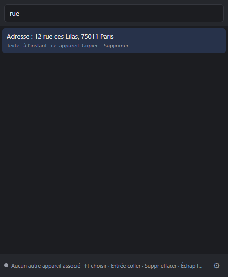

<div align="center">


# MyPress

**Votre presse-papiers, sur tous vos ordinateurs.**

Copiez sur un PC, collez sur l'autre. Retrouvez tout ce que vous avez copié avec `Ctrl+Alt+V`.<br>
Pair à pair, chiffré de bout en bout, sans compte et sans serveur obligatoire.

[](https://github.com/williamloree/MyPress/releases/latest)
[](https://github.com/williamloree/MyPress/releases)
[](https://github.com/williamloree/MyPress/actions/workflows/release.yml)
[](LICENSE)
<br>
[](#installation)
[](#installation)
[](#installation)
[](https://www.rust-lang.org)
[](https://tauri.app)
[](https://iroh.computer)

[**Télécharger**](https://github.com/williamloree/MyPress/releases/latest) ·
[Installation](#installation) ·
[Utilisation](#utilisation) ·
[Comment ça marche](#comment-ça-marche) ·
[Contribuer](#contribuer)

</div>

<table align="center">
<tr>
<td align="center"><br><sub><b>Panneau rapide</b> · <code>Ctrl+Alt+V</code></sub></td>
<td align="center"><br><sub><b>Recherche</b> · thème sombre</sub></td>
<td align="center"><br><sub><b>Appareils</b> · association par code</sub></td>
</tr>
</table>

## Pourquoi MyPress

Le presse-papiers de Windows oublie tout au redémarrage, et sa synchronisation passe par un compte
Microsoft. MyPress garde un historique consultable au clavier et le partage directement entre vos
ordinateurs : rien ne transite en clair, aucun compte n'est demandé, et il n'y a pas de serveur à
héberger pour l'utiliser.

## Fonctionnalités

- 📋 **Historique** des textes, liens et extraits de code copiés, avec recherche (insensible aux majuscules et aux accents).
- ⚡ **Panneau rapide** `Ctrl+Alt+V` : flèches pour choisir, `Entrée` colle directement dans l'application d'avant.
- 🔄 **Synchronisation pair à pair** entre ordinateurs, même sur des réseaux différents. Copiez sur un PC,
  `Ctrl+V` sur l'autre.
- 🔒 **Chiffrement de bout en bout** : seuls vos appareils peuvent lire votre historique.
- ✈️ **Hors ligne d'abord** : tout est enregistré localement et rattrapé à la reconnexion.
- 🕶️ **Vie privée** : copies des gestionnaires de mots de passe ignorées, mode privé, pause de la synchronisation.
- 🚀 **Mises à jour automatiques** et signées, depuis les releases GitHub.
- 🎨 Taille d'historique au choix (50 à 1000), thème clair ou sombre, lancement au démarrage.

## Installation

Téléchargez l'installateur de votre système dans la [dernière release](https://github.com/williamloree/MyPress/releases/latest).
Aucun Java, Python ni droit administrateur requis.

| Système | Fichier | Remarques |
|---|---|---|
| **Windows 10/11** | `MyPress_x.y.z_x64-setup.exe` | Si SmartScreen s'affiche : *Informations complémentaires* › *Exécuter quand même*. Autoriser l'accès réseau si le pare-feu le demande. |
| **macOS** (Apple Silicon) | `MyPress_x.y.z_aarch64.dmg` | Glisser dans *Applications*, puis clic droit › *Ouvrir* au premier lancement. |
| **macOS** (Intel) | `MyPress_x.y.z_x64.dmg` | Si « endommagée » : `xattr -cr /Applications/MyPress.app`. Autoriser l'*Accessibilité* pour le raccourci. |
| **Linux** | `.AppImage`, `.deb`, `.rpm` | `chmod +x MyPress_*.AppImage && ./MyPress_*.AppImage` ou `sudo apt install ./MyPress_*.deb`. Raccourci global sous X11. |

> [!NOTE]
> Les installateurs ne sont pas encore signés par un certificat éditeur, d'où les avertissements de
> Windows et macOS au premier lancement.

**Mises à jour** : à partir de la 0.1.1, MyPress vérifie les releases au démarrage puis toutes les 6 heures,
installe la nouvelle version et redémarre tout seul (Windows, macOS, Linux). Une mise à jour non signée
par la clé du projet est refusée. La 0.1.0 n'a pas cette fonction : installer la 0.1.1 une fois à la main.

## Utilisation

| Action | Raccourci |
|---|---|
| Ouvrir l'historique | `Ctrl+Alt+V` ou clic sur l'icône de la barre des tâches |
| Choisir un élément | `↑` `↓` ou la souris |
| Coller dans l'application d'avant | `Entrée` ou clic |
| Supprimer un élément | `Suppr` |
| Fermer | `Échap` |
| Mode privé, pause de la synchronisation | Clic droit sur l'icône de la barre des tâches |

### Associer un deuxième ordinateur

1. Sur le premier : *Paramètres* › **Ajouter un appareil** › *Copier le code*.
2. Envoyer ce code (`MP1-…`) au second ordinateur, par exemple par message.
3. Sur le second : *Paramètres* › **Rejoindre un autre ordinateur**, coller le code, *Rejoindre*.

Le code sert une seule fois et expire après 15 minutes ; le premier ordinateur doit être allumé. Les deux
historiques sont fusionnés. Pour retirer un appareil perdu ou revendu : *Paramètres* › *Retirer* ; il ne
peut plus lire les nouvelles copies.

### Boîte aux lettres (optionnelle)

Sans elle, deux ordinateurs se synchronisent quand ils sont allumés en même temps. Avec elle, un ordinateur
rallumé récupère aussi ce qui a été copié pendant son absence. C'est un petit serveur à héberger soi-même
([voir plus bas](#héberger-la-boîte-aux-lettres)) ; son adresse se règle sur un seul appareil et s'applique à tous.

## Comment ça marche

```text
 PC fixe ◄──── QUIC chiffré (iroh) ────► Portable
    │      direct si possible, relais sinon     │
    └────────► Boîte aux lettres ◄──────────────┘
               (optionnelle, contenu chiffré)
```

- **Groupe d'appareils.** Pas de compte : le premier ordinateur crée une clé de groupe aléatoire, transmise
  aux autres lors de l'association.
- **Pair à pair.** Chaque ordinateur est identifié par une clé Ed25519 et joint les autres via
  [iroh](https://iroh.computer) : connexion directe (perçage NAT) si possible, sinon relais publics de n0.
  Seuls les membres du groupe sont acceptés.
- **Fusion.** À la connexion, chaque appareil envoie la liste de ses éléments et reçoit ce qui lui manque ;
  ensuite chaque copie est transmise aussitôt. Une suppression l'emporte toujours.
- **Chiffrement.** XChaCha20-Poly1305 avec une clé dérivée de la clé du groupe. La boîte aux lettres ne reçoit
  que du contenu chiffré et un secret d'accès qui ne permet pas de déchiffrer.
- **Retrait d'un appareil.** Nouvelle clé de groupe, transmise aux appareils restants en P2P et via la boîte
  aux lettres (chiffrée pour chacun avec X25519).
- **Stockage.** Clés de l'appareil dans le coffre du système (Gestionnaire d'identification Windows, Trousseau
  macOS, Secret Service) ; historique dans une base SQLite locale.

## Développement

Prérequis : [Rust](https://rustup.rs), [Node.js](https://nodejs.org) 22 et [pnpm](https://pnpm.io).

```sh
git clone https://github.com/williamloree/MyPress.git
cd MyPress/app
pnpm install
pnpm tauri dev
```

| Dossier | Rôle |
|---|---|
| [`crates/proto`](crates/proto) | Formats échangés et chiffrement |
| [`app/src-tauri`](app/src-tauri) | Client : presse-papiers, historique, raccourci, collage, P2P, boîte aux lettres, mises à jour |
| [`app/src`](app/src) | Interface (TypeScript, Vite) |
| [`server`](server) | Boîte aux lettres (Axum, SQLite) |

**Tests** : `cargo test --workspace`. [`app/src-tauri/tests/devices.rs`](app/src-tauri/tests/devices.rs) fait
tourner trois appareils et une boîte aux lettres dans un même processus : association, fusion, suppression,
coupure, boîte aux lettres, retrait d'appareil.

**Second appareil en ligne de commande** (vrai réseau iroh), pratique pour tester :

```sh
cargo run -p mypress --example peer -- MP1-... "texte à copier"
```

### Publier une version

1. Augmenter `version` dans [`app/src-tauri/tauri.conf.json`](app/src-tauri/tauri.conf.json) (sinon les
   applications installées ne voient pas la mise à jour).
2. Pousser un tag : `git tag v0.1.2 && git push origin v0.1.2` (ou *Actions › Build & Release › Run workflow*).

[GitHub Actions](.github/workflows/release.yml) lance les tests, construit les installateurs Windows, macOS et
Linux et les publie dans une release avec le `latest.json` des mises à jour. Les paquets sont signés avec les
secrets `TAURI_SIGNING_PRIVATE_KEY` et `TAURI_SIGNING_PRIVATE_KEY_PASSWORD` (clé publique dans
`tauri.conf.json`) ; perdre cette clé empêche toute mise à jour automatique.

En local : `cd app && pnpm tauri build` (installateur du système courant, dans `target/release/bundle/`).

### Héberger la boîte aux lettres

```sh
docker build -f server/Dockerfile -t mypress-server .
docker run -d -p 8787:8787 -v mypress-data:/data mypress-server
```

À placer derrière un proxy HTTPS (Caddy, Traefik, nginx). Variables : `MYPRESS_BIND`, `MYPRESS_DB`, `RUST_LOG`.
Elle garde au plus 1000 éléments par groupe et les marqueurs de suppression 60 jours.

## Feuille de route

- [x] Historique, recherche, panneau `Ctrl+Alt+V` et collage automatique (Windows)
- [x] Synchronisation pair à pair chiffrée de bout en bout
- [x] Boîte aux lettres optionnelle auto-hébergée
- [x] Installateurs Windows, macOS, Linux et mises à jour automatiques
- [ ] Images, texte enrichi et fichiers
- [ ] Collage automatique sous macOS et Linux
- [ ] Raccourci personnalisable
- [ ] Installateurs signés

## Limites connues

- Testé en conditions réelles uniquement sous Windows ; les versions macOS et Linux sont compilées par la CI
  mais pas encore éprouvées.
- Le collage automatique est refusé par les applications lancées en administrateur (protection de Windows).
- Dépend des services publics de n0 (découverte et relais) ; ils voient quels appareils communiquent, jamais
  le contenu.
- Tout membre du groupe peut ajouter ou retirer des appareils. Un appareil retiré pourrait encore tromper un
  membre qui n'a pas appris la révocation, ou vider l'ancienne boîte aux lettres.
- L'ordre de l'historique se base sur l'horloge de chaque ordinateur.

## Contribuer

Les contributions sont les bienvenues : signalez un bug ou proposez une idée dans les
[issues](https://github.com/williamloree/MyPress/issues), ou ouvrez une pull request. Avant d'envoyer du code,
vérifiez que `cargo test --workspace` passe.

## Licence

Distribué sous [licence MIT](LICENSE).

<div align="center">
<sub>Fait avec Rust, Tauri et iroh · Si MyPress vous est utile, une ⭐ fait plaisir.</sub>
</div>
